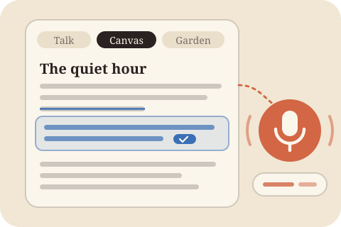

  

# Talk to Write

  

Didn't work? Create a Studio workspace and paste this to your agent:
` /use-template https://github.com/kanjun/talk-to-write`

## Why you care

Some of your best ideas come out when you talk, and then they get lost or flattened
when you try to type them up. Talk to Write lets you think out loud at your draft and
turns what you said into suggestions made of your own words, so the writing still
sounds like you and not like an AI.

## How to use it

Open **Talk to Write** from your desktop, or on your phone (it is built to be used from a phone too).

- **Talk at your draft.** Open a document on the **Canvas**, tap the mic and talk:
  "this paragraph is missing the point about trust", "add what I said on my walk to the
  opening", "give me a few ways to say this line". Highlight words first to point at
  them. The writing chat answers out loud in a sentence or two.
- **Accept what you like.** Its changes show up in the document in blue: the new
  wording right under what it would replace. Accept, skip, or edit a suggestion before
  taking it. New ideas come in as your own spoken sentences, cleaned up; nothing is
  written in someone else's voice.
- **Ask for edits in your voice.** "Suggest edits" (the button, or say it) gives line
  edits section by section: small fixes you can combine, fuller rewrites, and a short
  reason for each. Point it at folders of your own writing and each edit also shows
  the line of yours it is modelled on.
- **Write in your notes.** Connect an Obsidian-style notes folder and the **Garden**
  tab lets you read, search, talk to, and edit those notes in place. Deleted notes go
  to the folder's trash, so they can be brought back.
- **Get something to look at.** Ask the chat to make a page ("make me a map of how
  this essay's argument flows") and it appears on the Canvas next to your documents.
- **Choose how it talks back.** In Settings, pick a mode (find what I mean, clarify,
  expand, challenge, make it usable), tune dials like fast/deep or affirm/challenge,
  or invite a few people whose thinking you admire to discuss your idea with you.

Every piece keeps a history of everything you said about it, plus earlier versions
you can go back to, so you can pick up where you left off.

## Ideas for making it yours

- Swap the talk-back modes and dials for the kinds of pushback you actually want
  (for example, a "find the strongest objection" mode).
- Change the look of pages the chat makes to match your own site or brand.
- Teach the writing chat your house style: words you never use, how you like
  headings, British or American spelling.
- Add a button that sends a finished piece somewhere: a blog's drafts folder, an
  email to yourself, or a shared document.
- Make the Garden show only the notes you've marked public, as a quick check of what
  a published site would show.

## What this is

This repository is a published **Imbue Studio template**: a clean, bootable
snapshot of what an agent built, ready to adapt into your own. It is NOT the
generic workspace template -- it is this specific project.

[`template.md`](template.md) is the full manifest -- what it is, how it
works, what it needs to run, and what to adapt -- with the
machine-readable half (recipe, requirements, and the environment it needs
installed) in [`template.toml`](template.toml).
